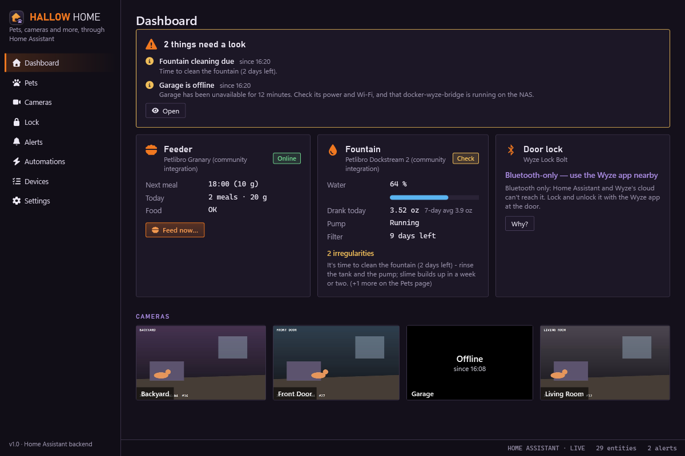
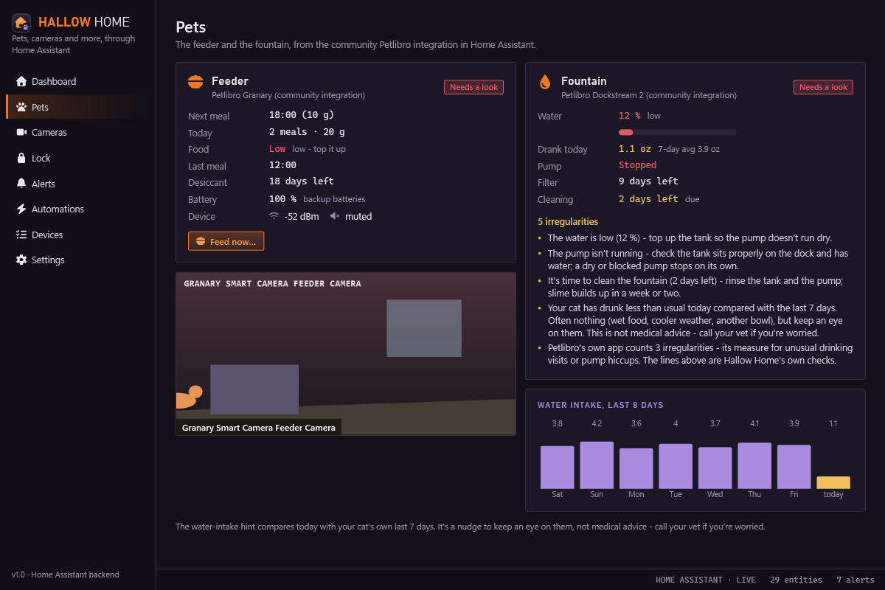
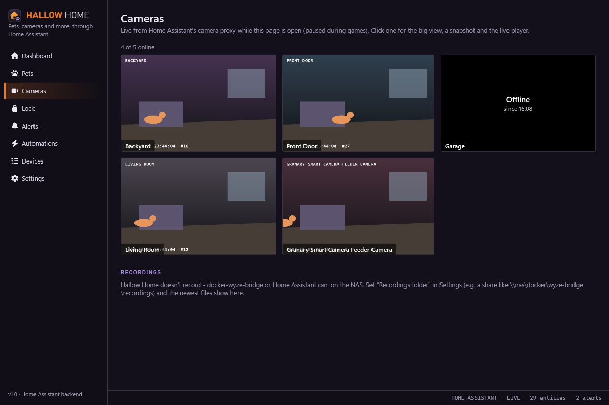
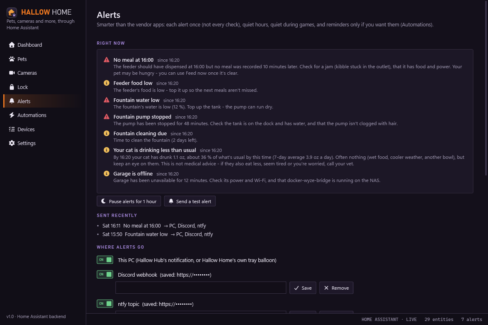
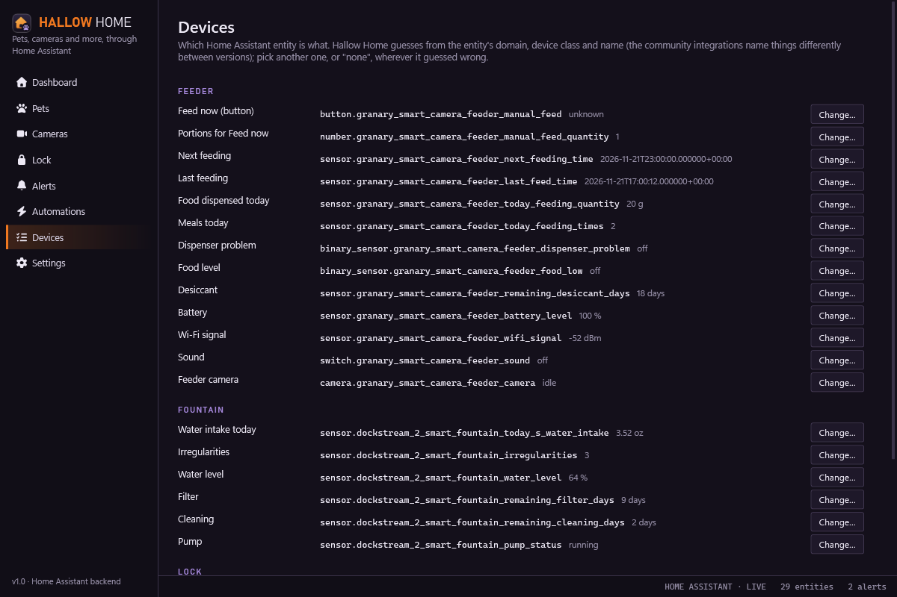

# Hallow Home

**One private app for your smart-home and pet devices - with Home Assistant as the backend.**

Part of the Hallow family of Windows apps. Hallow Home shows your pet feeder and water fountain, your cameras and your door lock in
one window, sends smarter alerts than the vendor apps, and runs a few simple automations. Everything goes through **Home Assistant
(HA)** on your NAS - Hallow Home is only the PC side and never talks to Petlibro's or Wyze's cloud itself. Home Assistant is **not**
included: [NAS-SETUP.md](NAS-SETUP.md) shows the Docker setup.

## Be honest first: what depends on what

- **Petlibro feeder and fountain** (Granary Smart Camera Feeder, Dockstream 2): through the **community Petlibro integration**
  (HACS, unofficial - not made or supported by Petlibro). It uses Petlibro's cloud API, which can change and break it for a while.
  Hallow Home can only show what it exposes.
- **Wyze cameras**: through the community **docker-wyze-bridge** (RTSP / WebRTC / HLS) added to HA as cameras; other Wyze devices
  through the community **Wyze integration** (HACS). Both need your Wyze API key from Wyze's developer console.
- **Wyze Lock Bolt: not controllable.** It's **Bluetooth-only** - no Wi-Fi, no hub, no Wyze cloud control. Wyze's API and the Wyze
  integration can't reach it, and no maintained Home Assistant integration for it could be verified (late 2026: one forum report of
  someone doing it with their own Bluetooth setup, nothing published). Hallow Home shows it as **"Bluetooth-only - use the Wyze app
  nearby"** and explains why. There is an extension point: if a `lock.*` entity for it ever appears in HA (for example a future
  community integration through an **ESPHome Bluetooth proxy**), map it on the Devices page and Hallow Home shows it - no promise.
- **Alerts and automations only run while Hallow Home runs** (it can start with Windows, in the tray). For anything that must work
  with the PC off, make an automation in Home Assistant itself.

## What it does

- **Dashboard**: what needs a look, the feeder, the fountain, the lock and the first cameras.
- **Pets**
  - Feeder: **next meal** and its grams, **today's meals and grams**, **food level**, desiccant, backup battery, Wi-Fi and the
    muted icon, the feeder's camera, and **Feed now** - you pick 1-6 portions (about 10 g each, set in Settings) and confirm; only
    then does it set the portions and press the feeder's manual-feed button in HA.
  - Fountain: **water level**, **today's intake vs the 7-day average** (a small 8-day chart), **filter** and **cleaning** days,
    **pump status**, and the **irregularities explained in plain words** ("the pump isn't running - check the tank sits on the dock...").

  
- **Cameras**: a live grid from Home Assistant's camera proxy (MJPEG; the token stays in a header, never in a URL), only while the
  page is open and never while you play. Click one for the big view, a **snapshot** (saved to Pictures\Hallow Home) and an optional
  **live view** - docker-wyze-bridge's own WebRTC / HLS player in a WebView2 window. **Recordings**: set the folder where the bridge
  or HA records on the NAS and the newest files are listed (Hallow Home never records or deletes anything).

  
- **Smart alerts**, to this PC (Hallow Hub's notification or the tray), a **Discord webhook** and/or an **ntfy** topic you set
  (both kept encrypted, never logged; only the alert's title and text are sent):
  - **No meal dispensed when scheduled** (a jam): the meal time passed and, 10 minutes later, the feeder's last-feed time didn't move
    and today's meal count didn't go up - or its own dispenser-problem sensor is on. **Food low.**
  - **Fountain water low**, **pump stopped** (for 30 minutes - an intermittent mode doesn't count), **filter or cleaning due**,
    **water intake unusually low today** compared with your cat's own last 7 days for this time of day (a health hint - **not medical
    advice**; call your vet if you're worried).
  - **Camera offline** (for 5 minutes), **motion while away** (off by default; "away" = everyone's HA person entity is away, or
    "I'm away" in the app - Hallow Places can tell it later).
  - **De-duplicated** (one message when it starts, not every check; it can come back only after being fixed for 10 minutes),
    **quiet hours** (held, sent when they end if still true), **pause for 1 hour**, and **quiet during games**: the PC never pops
    anything up while Delta Force, Discovery or a game Hallow Hub sees is running; your phone still gets alerts unless you choose
    "hold everything".

  
- **Automations (simple)**: "when X then Y", e.g. *fountain water low -> remind me twice a day until it's fixed* (on by default) or
  *everyone's away -> turn the cameras on* (pick the Wyze integration's camera power switches). They may only send reminders or turn
  switches / lights / cameras on or off - **never unlock a door, never feed**.
- **Devices (the mapping layer)**: the community integrations name their entities differently from version to version, so Hallow
  Home recognises each role (feeder food level, manual-feed button, fountain pump...) by **domain, device class and name patterns**
  within that device's own entities. Every guess is shown and can be changed - "this entity is the feeder's food level", or "none".

  
- **Lock**: the honest card above.
- **Light and dark** (follows Hallow Toolkit's switch or its own Look), the Hallow accent, Hub's one Hallow icon, crash reports kept
  on this PC, updates from GitHub with the checksum checked.

## Install

Download `Hallow.Home.zip` from the [latest release](https://github.com/Dom428/hallow-home/releases/latest), right-click it >
Properties > **Unblock**, Extract All, double-click **INSTALL.bat** (no admin). Or install it from **Hallow Setup**.
Then: set up Home Assistant ([NAS-SETUP.md](NAS-SETUP.md)), make a long-lived access token (HA: your profile > Security), and paste
the address and token on Hallow Home's Settings page.

Needs Windows 10/11 x64 and .NET Framework 4.8 (built in). The optional live view uses the Microsoft Edge WebView2 Runtime (built into
Windows 11; Hallow Home never downloads it).

## Privacy and safety

- The HA token, the Discord webhook and the ntfy topic (+ token) are stored in `%APPDATA%\HallowHome\secrets.dat`, encrypted with
  **Windows DPAPI for your Windows user**; never logged, never in settings.json, status, the family pipe or crash reports.
- Hallow Home talks only to your Home Assistant, plus Discord / ntfy if you set them, plus GitHub for updates.
- It warns when the HA address is plain `http` over the internet. See NAS-SETUP.md's warning before publishing HA (Cloudflare Access
  or HA's login with MFA in front; never the cameras unauthenticated).
- Feeding always needs a confirm (the dialog, or `confirm` over the family pipe). Unlocking (if a lock ever works) always asks and is
  never offered over the pipe or to automations.

## Hallow family link

- Pipe `HallowFamily.Home.<user>` / `HallowHome.exe --cmd <line>`: `ping`, `status` (counts and alert flags only - no camera URLs,
  addresses or tokens), `feed <portions> confirm` (without `confirm` nothing is dispensed), `away on|off`, `open [page]`, `menu`,
  `invoke <id>`, `quit`.
- `%APPDATA%\HallowHome\status.json` for apps that only read; Hallow Hub's tray lists it (generic host). A phone view through
  Hallow Remote comes later - the pipe and status are ready for it.

## Building and testing

`.\build.ps1 -Tests` builds `HallowHome.exe` and `tests\HomeTests.exe` with the C# compiler that ships with Windows. The tests run
against a **fake Home Assistant** (`tests\FakeHa.cs`): REST, the WebSocket API with `state_changed`, service calls with the effects
a feeder would have, an MJPEG camera made of generated frames, and made-up entities modelled on the community Petlibro and Wyze
integrations (feeder, fountain, cameras, an unavailable Lock Bolt). They cover the mapping and overrides, Feed now only after a
confirm, every alert rule (the jam and the low-intake check on synthetic data), de-duplication and quiet hours, the camera grid
loading the fake stream, the live view, token encryption and the pipe. `HallowHome.exe --snap <folder>` renders every page in light
and dark with made-up devices. Icons: Font Awesome Free (CC BY 4.0). WebView2 SDK: Microsoft (see WebView2-LICENSE.txt).
